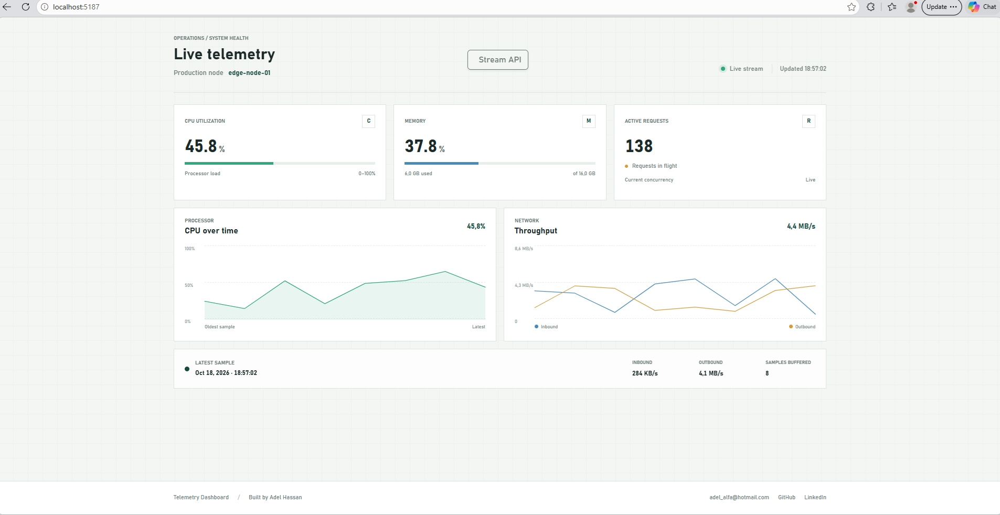

# .NET 10 Real-Time Live Telemetry Dashboard

[](https://dotnet.microsoft.com/)
[](https://dotnet.microsoft.com/apps/aspnet/blazor)
[](https://learn.microsoft.com/aspnet/core/fundamentals/minimal-apis)
[](https://developer.mozilla.org/en-US/docs/Web/API/Server-sent_events)
[](LICENSE)

> **Enterprise-grade, real-time telemetry dashboard** that monitors system metrics — **CPU utilization, Memory usage, Network I/O, and Active Connections** — streaming live data from a .NET 10 Minimal API backend to an interactive Blazor Server frontend over Server-Sent Events (SSE).

Built with **Clean Architecture** and **Domain-Driven Design (DDD)**, the solution keeps business logic pure and dependency-free while the presentation layer reacts to every metric sample the instant it arrives.

---
> 🚀 **[Check out the Live Demo here!](https://telemetrydashboard-y37x.onrender.com/)**
---
## 📸 Screenshots

<div align="center">



_Production node `edge-node-01` with live metric widgets, SVG history charts, and reactive connection state._

</div>

---

## 📄 Project Prompt (AI Assistant Specification)

The implementation of this project was guided by the original specification authored for an AI assistant agent. The full prompt is available here:

📎 **[`src/docs/Project_Prompt.txt`](./src/docs/Project_Prompt.txt)**

<details>
<summary>Click to expand the original project prompt</summary>

```text
Role:
You are a Principal Software Architect specializing in enterprise .NET systems.
You enforce strict architectural integrity, Clean Architecture, and Domain-Driven
Design (DDD) principles. Every line of code produced must align with the
established system design, and architectural boundaries are non-negotiable.

Task:
Design and implement an end-to-end Live Telemetry Dashboard application that
streams real-time system metrics (CPU, Memory, Network I/O, Active Requests)
from a .NET 10 Minimal API backend to an interactive Blazor Server dashboard
using Server-Sent Events (SSE).

Tech Stack & Architecture:
- Backend: .NET 10, ASP.NET Core, Minimal APIs, Clean Architecture, DDD
- Frontend: .NET 10 Blazor Server, Bootstrap CSS
- Real-Time Communication: Server-Sent Events (SSE) using
  TypedResults.ServerSentEvents for streaming IAsyncEnumerable<T> data types.

Specifications & Requirements:
1. Architecture Layout (Clean Architecture):
   - Domain Layer: Pure business logic, core entities, value objects, and
     domain exceptions (zero external dependencies).
   - Application Layer: Use cases, application services, interfaces, and DTOs.
   - Infrastructure Layer: External data providers, persistence, and SSE
     stream orchestration.
   - Presentation/Web Layer: ASP.NET Core Minimal APIs and Blazor Server UI
     components.
2. Backend (Minimal API & SSE):
   - Expose a Minimal API endpoint that streams data asynchronously using
     IAsyncEnumerable<TelemetryMetric>.
   - Utilize TypedResults.ServerSentEvents for straightforward, native
     streaming of enumerable data types.
   - Simulate a real-time data stream by asynchronously yielding random
     metric values with controlled time delays.
3. Frontend (Blazor Server & Bootstrap):
   - Create an interactive dashboard styled with Bootstrap CSS.
   - Include dynamic visual diagrams/charts that update in real-time as data
     arrives.
   - Implement a robust client-side SSE consumer using .NET HttpClient and
     asynchronous stream reading.
```

</details>

---

## 🏗️ Architecture & Design Principles

The solution follows **Clean Architecture** and **Domain-Driven Design (DDD)**. Dependencies point **inward** — the Domain layer has no external dependencies, the Application layer depends only on Domain, Infrastructure depends on Application and Domain, and the Presentation layer composes everything.

### Solution Layers

| Layer              | Project                             | Responsibility                                                                                                                                   | Dependencies                |
| ------------------ | ----------------------------------- | ------------------------------------------------------------------------------------------------------------------------------------------------ | --------------------------- |
| **Domain**         | `TelemetryDashboard.Domain`         | Core business model: `TelemetryMetric` entity, `MemoryUsage` and `NetworkIo` value objects with built-in validation. Zero external dependencies. | None                        |
| **Application**    | `TelemetryDashboard.Application`    | Application contracts: `ITelemetryStream` interface defining the asynchronous telemetry stream.                                                  | Domain                      |
| **Infrastructure** | `TelemetryDashboard.Infrastructure` | Stream implementation: `RandomTelemetryStream` produces simulated metric samples on a one-second interval using `TimeProvider`.                  | Application, Domain         |
| **Presentation**   | `TelemetryDashboard.Web`            | ASP.NET Minimal API SSE endpoint + Blazor Server dashboard UI. Composes all layers.                                                              | Application, Infrastructure |

---

## 🔄 Development Decision: Real-Time Communication

Several real-time communication strategies were evaluated before selecting Server-Sent Events:

| Option                       | Direction                   | Best For                                                     | Trade-off                                                          |
| ---------------------------- | --------------------------- | ------------------------------------------------------------ | ------------------------------------------------------------------ |
| **SignalR**                  | Bi-directional              | Chat, collaborative apps, frequent client-to-server messages | Higher complexity; overkill for server-only pushes                 |
| **WebSocket**                | Bi-directional              | Low-latency full-duplex protocols                            | Requires persistent socket management; heavier client stack        |
| **Server-Sent Events (SSE)** | **Server → Client**         | **Telemetry, dashboards, live feeds**                        | **Simple HTTP, automatic reconnection, text-based, easy to debug** |
| Long Polling                 | Server → Client (simulated) | Legacy environments without SSE support                      | High latency, wasteful request/response overhead                   |

### Rationale: SSE vs SignalR

The dashboard is fundamentally **unidirectional** — the server pushes telemetry samples to the client, and the client never needs to send messages back over the real-time channel. For this pattern:

- **SSE is purpose-built for server-to-client streaming** over standard HTTP, with built-in automatic reconnection and event framing (`data:` / `event:` fields).
- **SignalR is optimized for bi-directional communication**, which adds connection-hub complexity and transport negotiation (WebSockets, ServerSentEvents, LongPolling fallbacks) that provides no benefit for a unidirectional telemetry feed.
- SSE integrates directly with .NET 10's `TypedResults.ServerSentEvents` and `IAsyncEnumerable<T>`, allowing the backend to stream the telemetry sequence natively without a hub abstraction.

**Decision:** Server-Sent Events (SSE) was chosen as the transport because it matches the unidirectional server-to-client telemetry flow, minimizes moving parts, and leverages first-class .NET 10 minimal API streaming support.

---

## 👤 Author

**Adel Hassan** · Enterprise .NET Architect & Open Source Maintainer  
📧 adel_alfa@hotmail.com  
🐙 [GitHub](https://github.com/Adel-alfa)  
💼 [LinkedIn](https://linkedin.com/in/adel-hassan-ly)


## 📄 License

This project is licensed under the [MIT License](LICENSE).

---
🌐 **Total Visitors:**
---

